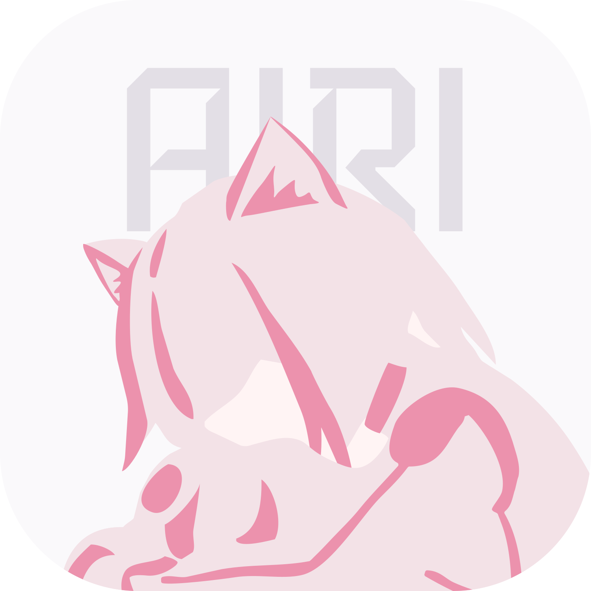
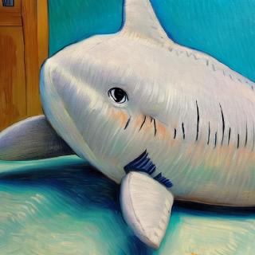
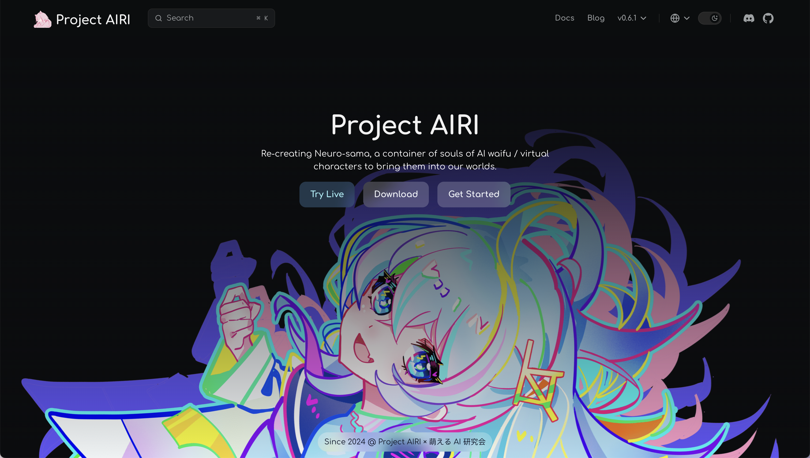
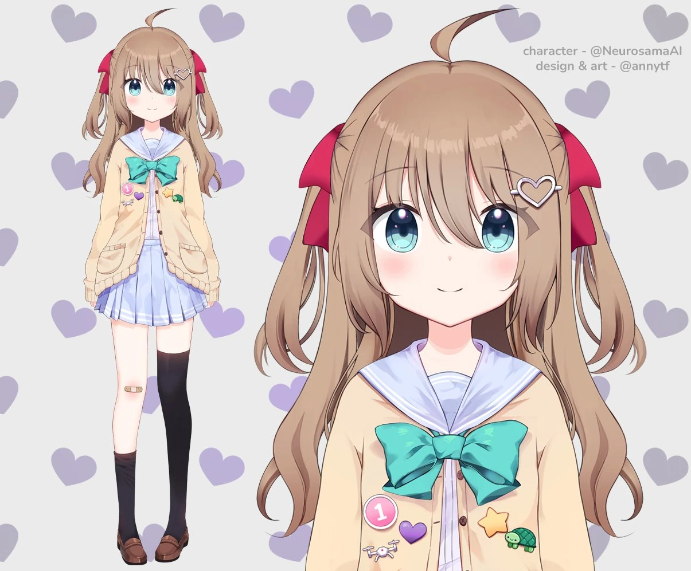
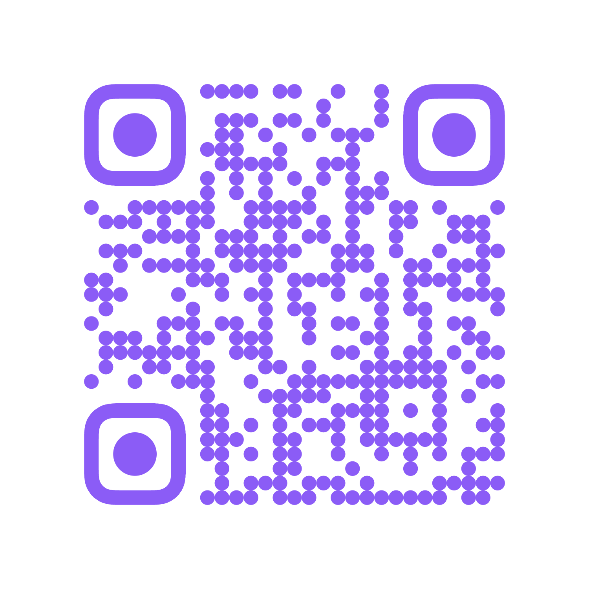
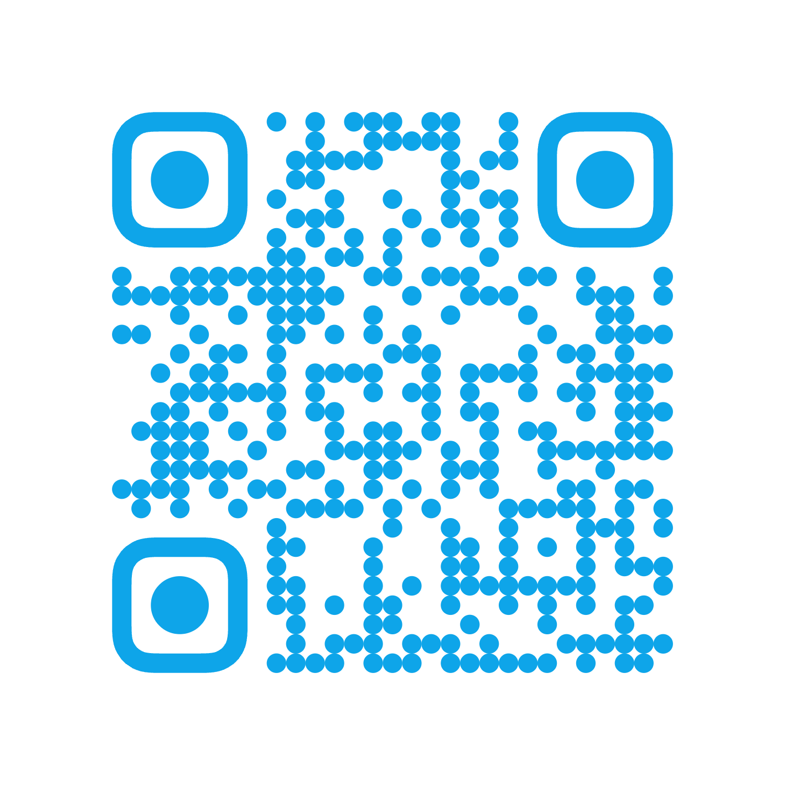

<!-- slide:A1 -->

<div text-sm font-semibold tracking-widest uppercase text="white/75">GOSIM Shenzhen 2026</div>

<h1 text="[60px]!" leading="[1.02]!" font-bold mt-3 style="text-shadow: 0 4px 22px rgb(10 37 64 / 45%);">
Agentic in Game AI,<br>
<span text="[#F9C4DA]">did we get any far?</span>
</h1>

<div mt-4 text-lg text="white/88" max-w-130 font-medium>
From playable demos to environments and datasets for reinforcement learning
</div>
<div text-sm text="white/70" mt-1>游戏里的智能体，我们走了多远？</div>

<div mt-6 flex items-center gap-3 text-base>
  
  <span font-semibold>Neko Ayaka</span>
  <span text="white/65">· Project AIRI / Moeru AI</span>
</div>

<!--
[Neko]
大家好，我是 Neko。今天的题目问得有点直白：Agentic in Game AI，我们到底走了多远？

这是一个入门向的分享。我会先花几分钟讲讲游戏 AI 这十几年发生了什么，然后讲我们自己在各种游戏里踩过的坑，最后讲我们为什么开始做「证据」——录制、标注、数据集，以及接下来想研究的方向。
-->

---
layout: intro
class: px-35
clicks: 2
---

<!-- slide:A2 -->

<div flex>
  <div
    v-click="1" flex flex-col items-start transition duration-500 ease-in-out
    :class="$clicks < 1 ? 'translate-x--20' : 'translate-x-0'"
  >
    
    <span font-semibold text-3xl>Neko Ayaka</span>
    <div>
      <div>
        <span class="opacity-70">Creator of Project AIRI · LobeHub</span>
      </div>
      <div text-sm flex items-center gap-2 mt-4>
        <div i-ri:github-fill /><span underline decoration-dashed font-mono decoration-zinc-300>nekomeowww</span>
      </div>
    </div>
  </div>
  <div flex-1 />
  <div
    v-click="2" flex flex-col items-end transition duration-500 ease-in-out
    :class="$clicks < 2 ? 'translate-x-20' : 'translate-x-0'"
  >
    
    <span font-semibold text-3xl>Rin</span>
    <div flex-col items-end>
      <div text-right>
        <span class="opacity-70">Airicraft, recorder-minecraft</span>
      </div>
      <div text-sm flex items-center justify-end gap-2 mt-4>
        <div i-ri:github-fill /><span underline decoration-dashed font-mono decoration-zinc-300>shinohara-rin</span>
      </div>
    </div>
  </div>
</div>

<!--
[Neko]
[click] 我是 Neko，Project AIRI 的发起人，平时在 LobeHub 工作。

[click] 这位是 Rin，英文名 Claudia Wang。今天你们在 Minecraft 里看到的东西，Airicraft、recorder，还有周边很多生态，主要都是她做的。团队里其他伙伴，最后一起介绍。
-->

---
glow: center
---

<!-- slide:A2b -->

<div h-full flex items-center justify-center>
  <PreviousSessions />
</div>

<!--
[Neko]
这不是我第一次上台讲 AIRI。去年在杭州讲过 AIRI 是怎么从零做出来的，在香港 KubeCon 讲过大模型的基础设施，在复旦讲过 AIRI 的开发幕后；今年年初讲了机器人，5 月讲了我们在游戏 agent 上踩过的坑，7 月在 Vue Conf 讲了怎么用写前端的思路写 agent。

每张封面背后都藏了一个二维码，想看之前内容的，会后可以扫一下。今天这场，算是把这一年多在游戏里的尝试串起来讲一遍。
-->

---
clicks: 2
---

<!-- slide:A3 -->

<div grid="~ cols-[1.05fr_1fr]" gap-10 h-full items-center>
  <div>
    <h1>A friend who plays games with you</h1>
    <span class="zh">我们想做一个日常陪我们一起玩的数字生命。</span>
    <div v-click="1" mt-8 text-xl leading-9 font-medium>
      Chat mostly works today.<br>
      <span class="text-gradient">But can it sit next to you and <b>play</b>?</span>
    </div>
    <div v-click="2" mt-5 class="muted" text-sm leading-6>
      To play together, it must share your world: see what you see, act in real time, and understand what you mean.
      <div class="zh">一起玩，就得在同一个世界里：看到你看到的，跟得上节奏，还要听懂你在说什么。</div>
    </div>
  </div>
  <div relative h-90>
    
  </div>
</div>

<!--
[Neko]
先说说 AIRI 是什么。Project AIRI 想做的东西其实很简单：一个数字生命，能陪你玩游戏，也能陪你生活的伙伴。

[click] 聊天这件事，今天大家基本都能做到了。但是它能不能坐在你旁边，跟你一起玩？

[click] 一起玩，就得跟你待在同一个世界里：看见你看见的东西，跟得上你的节奏，还要听懂你到底想干嘛。这比聊天难太多了，也是今天整场分享的出发点。
-->

---
class: py-0! px-0!
clicks: 1
---

<!-- slide:A4 -->

<div>
  <div
    w-full h-full bg="black/15" absolute backdrop-blur-sm z-100
    :class="[$clicks < 1 ? 'opacity-0' : 'opacity-100']"
    transition duration-1200 ease-in-out
  />
  
  <div
    :class="$clicks < 1 ? 'opacity-0 translate-y-4' : 'opacity-100'"
    absolute inset-0 translate="x-60 y-36" w-fit h-fit
    transition duration-700 ease-out z-101
  >
    <div text="7xl" font-bold text-rose-400 style="-webkit-text-stroke: 6px #ffeef7; paint-order: stroke;">
      Neuro-sama
    </div>
    <div mt-3 text-white text-xl font-semibold style="text-shadow: 0 2px 12px rgb(0 0 0 / 50%);">
      An AI VTuber that plays games, live.
    </div>
    <div text-white text-sm opacity-90 mt-1 style="text-shadow: 0 2px 12px rgb(0 0 0 / 50%);">
      会直播、会聊天、会打游戏。可惜她不开源，下了播就见不到了。
    </div>
    <div flex gap-3 mt-4 rounded-xl bg="white/60" text="black/75" backdrop-blur-sm px-3 py-2 w-fit text-sm>
      <div flex items-center gap-2><div i-logos:youtube-icon text-xl /> 902k</div>
      <div flex items-center gap-2><div i-logos:twitch text-xl /> 1M+</div>
      <div flex items-center gap-2><div i-simple-icons:bilibili text-cyan-500 text-xl /> 1.09M</div>
    </div>
  </div>
</div>

<!--
[Neko]
这个想法从哪来？大家可能听说过 Neuro-sama。

[click] 她是一个 AI VTuber，会直播、会聊天、会玩游戏，各个平台都有接近或者超过一百万的订阅。她证明了这件事是可以做成的。

但她不是开源的，下播之后你就见不到她了。所以我们想做一个开源的、你自己拥有的版本，这就是 AIRI。
-->

---
wall: 0.28
clicks: 2
glow: center
---

<!-- slide:A5 -->

<div flex flex-col h-full>
  <div class="corner-soft" self-start>
    <h1 mt-1 mb-0!>AIRI grew as open source</h1>
    <span class="zh">一个小众的 side project，长成了五万星的开源项目</span>
  </div>
  <div flex-1 flex items-end>
    <CommunityBurst :clicks="$clicks" />
  </div>
</div>

<!--
[Neko]
AIRI 是 2024 年 12 月开源的。这是它的星星曲线，我们从第一颗星开始看。

[click] 前大半年基本是平的，到 2025 年 8 月突然一下涨起来，今年 3 月又冲了一次……一路到现在，五万多颗星，两百多位贡献者。

[click] proj-airi 和 moeru-ai 两个 GitHub 组织，加起来也有将近三千个关注者。背后滚动的这些头像，就是关注我们、给我们点星、给我们提代码的人。谢谢大家。

也正是因为有这么多人在用、在看，我们才更想把「陪你玩游戏」这件事认真做下去。

那今天想回答的问题就是：在游戏里做 agent，我们到底走了多远？先从游戏 AI 这些年的历史讲起。
-->

---
glow: left
---

<!-- slide:B0 -->

<div h-full flex flex-col justify-center pl-6>
  <div class="eyebrow">Part 01</div>
  <div text="[64px]" font-bold leading-none mt-3>A short history<br>of <span class="text-gradient">game AI</span></div>
  <div class="zh" text-lg!>大家一直有在尝试用 AI 玩各种游戏</div>
</div>

<!--
[Neko]
第一段，游戏 AI 简史。
-->

---
class: p-0!
clicks: 9
chrome: false
---

<!-- slide:B1 -->

<HistoryWall :clicks="$clicks" />

<!--
[Neko]
大家一直有在尝试用 AI 玩各种游戏，因为游戏有画面、有规则、有分数，也有输赢。我们从一块屏幕开始。

2013 年，DeepMind 的 DQN。一个网络只看画面和分数，2015 年的 Nature 论文里，它用同一套超参数学会了 49 款雅达利游戏。

[click] 旁边多了一块：2016 年 OpenAI 的 Gym。它厉害的地方不是哪个游戏，而是一个接口：reset、step、reward。后来几乎所有强化学习的智能体都活在这个循环里，待会儿我们还会回到它。

[click] 同一年，AlphaGo 4 比 1 赢了李世石。下得比人好，但它只会下围棋。

[click] 2019 年，AlphaStar 在星际争霸 2 里打到宗师，天梯排名超过 99.8% 的玩家。

[click] 同一年，OpenAI Five 赢了 Dota 2 世界冠军 OG，之后开放给全网挑战，7,215 胜 42 负。不过到这里为止，都是「一个游戏，一个专家」。

[click] 2022 年，OpenAI 的 VPT 换了个思路。先用一小批标注数据训练一个模型，去猜视频里的人按了什么键；再拿 7 万小时的 Minecraft 视频做行为克隆，第一次做出了钻石镐。

[click] 2023 年的 Voyager 是另一条路：大模型不按键，改成写代码，把会的东西攒成技能库。注意边上那块模糊的屏幕，这条线后面还有 CodeAct 和 Factorio 的学习环境。

[click] 2024 到 2025 年，DeepMind 的 SIMA 和 SIMA 2：一个智能体，只看屏幕、只用键鼠，走进很多 3D 游戏，连没见过的游戏也能上手。这就是大家说的通用游戏智能体。

[click] 今年 1 月，Player2 和 Elefant AI 开源了 Open P2P：一个实时玩游戏的模型，训练用了 8,300 多小时的人类游玩数据，模型用 MIT 协议开源。

[click] 镜头再拉远，你会发现这个世界比我们刚才走过的大得多。NVIDIA 的 NitroGen 从公开游戏视频里抽出手柄动作，覆盖一千多款游戏；Genie 3 能实时生成可以走进去玩的世界；字节 Seed 的 Lumine 用一个 7B 模型打了 5 个小时的原神主线；NetHack 到今天还几乎没人解决。还有大家可能看过的模型打宝可梦：Gemini 2.5 Pro 去年 5 月在 harness 的帮助下通关了蓝版，Claude 今年 5 月通关红版，前后花了差不多一年。

所以，我们走了多远？在单个游戏上，非常远。在「一个智能体陪你玩任何游戏」这件事上，才刚刚开始。

Sources: DQN (Nature 2015), Gym arXiv:1606.01540, AlphaGo vs Lee Sedol (2016), AlphaStar (Nature 2019), OpenAI Five arXiv:1912.06680, VPT arXiv:2206.11795, Voyager arXiv:2305.16291, CodeAct arXiv:2402.01030, SIMA 2 arXiv:2512.04797, Open P2P arXiv:2601.04575, NitroGen arXiv:2601.02427, FLE arXiv:2503.09617, BALROG arXiv:2411.13543, Genie 3 (Google DeepMind blog, Aug 2025), Lumine arXiv:2511.08892 (ByteDance Seed, Nov 2025).
Images: atari-2600.jpg (Wikimedia, Evan-Amos, public domain); alphago-lee-sedol-game4.jpg (Wikimedia, Wesalius, CC BY-SA 4.0); alphastar-sc2-vs-tlo.jpg (© Google DeepMind / Blizzard, AlphaStar blog, editorial use); dota2-the-international.jpg (Wikimedia, YJ, CC BY-SA 2.0); minecraft-gameplay.jpg (Wikimedia, Xbox México, CC BY 3.0); voyager-components.png (Voyager project page, Wang et al. 2023); sima2-hero.jpg (© Google DeepMind, SIMA 2 blog, editorial use); nitrogen-overview.webp (NitroGen project page, NVIDIA et al.); factorio-space-age.jpg (Wikimedia, Wube Software, CC BY-SA 4.0); nethack-ascension.png (Wikimedia, NetHack GPL).
-->

---
clicks: 3
glow: right
---

<!-- slide:B2 -->

<h1>Learn to press keys, or learn to call tools</h1>
<span class="zh">两条路：从画面学会按键，或者让大模型去调工具</span>

<div grid="~ cols-[1fr_auto_1fr]" gap-x-10 mt-10>
  <div v-click="1">
    <div flex items-center gap-3>
      <div i-ph:game-controller-bold text-4xl text-gosim-sky />
      <div text-3xl font-bold>Pixels → actions</div>
    </div>
    <div class="zh" text-lg! mt-1>端到端：画面进，按键出</div>
    <div mt-4 text-base font-semibold>DQN · VPT · SIMA · NitroGen · Open P2P</div>
    <div mt-4 flex flex-col gap-2 text-base>
      <div flex items-center gap-2 whitespace-nowrap><div i-ph:plus-circle-bold text-gosim-sky /> Fast and general <span class="muted" text-sm>快，能泛化</span></div>
      <div flex items-center gap-2 whitespace-nowrap><div i-ph:minus-circle-bold text-gosim-rose /> Needs lots of data, hard to explain <span class="muted" text-sm>吃数据，难解释</span></div>
    </div>
  </div>
  <div v-click="2" flex flex-col items-center>
    <div flex-1 w-px bg="[#0A2540]/15" />
    <div class="pill" my-3 text-sm font-bold>or</div>
    <div flex-1 w-px bg="[#0A2540]/15" />
  </div>
  <div v-click="2">
    <div flex items-center gap-3>
      <div i-ph:brain-bold text-4xl text-gosim-rose />
      <div text-3xl font-bold>LLM + tools</div>
    </div>
    <div class="zh" text-lg! mt-1>Agentic：大模型 + 工具 + 运行时</div>
    <div mt-4 text-base font-semibold>Voyager · CodeAct · Pokémon harnesses</div>
    <div mt-4 flex flex-col gap-2 text-base>
      <div flex items-center gap-2 whitespace-nowrap><div i-ph:plus-circle-bold text-gosim-sky /> Plans and talks <span class="muted" text-sm>会规划，能聊天</span></div>
      <div flex items-center gap-2 whitespace-nowrap><div i-ph:minus-circle-bold text-gosim-rose /> Slow, limited by its tools <span class="muted" text-sm>慢，上限看工具</span></div>
    </div>
  </div>
</div>

<div v-click="3" mt-9 flex items-center gap-4>
  <div w-12 h-12 rounded-full flex items-center justify-center shrink-0 style="background: #E87AA4">
    <div i-ph:arrows-merge-bold text-2xl text-white />
  </div>
  <div>
    <div text="[22px]" font-bold whitespace-nowrap>A companion needs <span style="color: #E87AA4">both</span>: a slow mind to plan, a fast body to play.</div>
    <div class="zh">想当一个陪玩，这两样我们都得要。</div>
  </div>
</div>

<!--
[Neko]
把刚才这段历史粗暴地分一下，其实就两条路。

[click] 第一条是端到端：画面进，按键出。DQN、VPT、SIMA、NitroGen、Open P2P 都在这条路上。它快，也能泛化，但特别吃数据，而且你很难说清它为什么这么做。

[click] 第二条就是今天的主题，agentic：大模型加工具，再加一个运行时。Voyager、CodeAct，还有打宝可梦用的那些 harness 都是这条路。它会规划、能聊天，但是慢，而且工具给到哪，它的上限就到哪。

[click] 我们的结论是：一个陪你玩的伙伴，两样都要。慢的脑子负责想，快的身体负责玩。后面整场分享都围绕这句话展开。
-->

---
glow: left
---

<!-- slide:C0 -->

<div h-full flex flex-col justify-center pl-6>
  <div class="eyebrow">Part 02</div>
  <div text="[64px]" font-bold leading-none mt-3>Seven games,<br><span class="text-gradient">seven problems</span></div>
  <div class="zh" text-lg!>每一个游戏都有一本难念的经</div>
</div>

<!--
[Neko]
第二段，我们自己试过的游戏。
-->

---
clicks: 4
glow: right
---

<!-- slide:C1 -->

<h1>AIRI plays Minecraft with Mineflayer</h1>
<span class="zh">受 Voyager 和 Mindcraft 启发，我们决定试试 Mineflayer</span>

<div grid="~ cols-[1.25fr_1fr]" gap-8 mt-8 items-start>
  <div v-click="1">
  <div class="glass c1-layers">
    <div class="c1-row"><div i-twemoji:eye class="c1-icon" /><b>Perception</b><span>events → YAML rules → signals</span></div>
    <div class="c1-row"><div i-twemoji:high-voltage class="c1-icon" /><b>Reflex</b><span>a state machine that can block LLM calls</span></div>
    <div class="c1-row"><div i-twemoji:brain class="c1-icon" /><b>Conscious</b><span>event queue + sandboxed JS planner</span></div>
    <div class="c1-row"><div i-twemoji:hammer-and-wrench class="c1-icon" /><b>Action</b><span>runs tasks with Mineflayer skills</span></div>
  </div>
  <div class="c1-source">The 4 layers of the old bot · from <code>airi/integrations/minecraft</code></div>
  </div>
  <div flex flex-col gap-4>
    <div v-click="2">
      <div text-2xl font-bold leading-tight>It worked, then problems came.</div>
      <div class="zh" text-base!>能跑，但真实世界里问题一个接一个</div>
    </div>
    <div v-click="3" grid="~ cols-2" gap-2 text-sm>
      <div class="pill" justify-start>🧩 mods on real servers</div>
      <div class="pill" justify-start>🧭 pathfinding</div>
      <div class="pill" justify-start>📐 spatial reasoning</div>
      <div class="pill" justify-start>📦 packets & protocol</div>
      <div class="pill" justify-start>🧱 thin API wrappers</div>
      <div class="pill" justify-start>📺 not first-person</div>
    </div>
    <div v-click="4" text-xs class="muted" leading-5>
      Voyager and Mindcraft also use Mineflayer. MineRL and MineDojo use Malmo. But players use modded servers.
    </div>
  </div>
</div>

<style>
.c1-layers {
  padding: 6px 18px;
  border-radius: 20px;
}
.c1-row {
  display: grid;
  grid-template-columns: 26px 100px 1fr;
  align-items: center;
  gap: 10px;
  height: 58px;
  white-space: nowrap;
}
.c1-row + .c1-row {
  border-top: 1px solid rgb(10 37 64 / 8%);
}
.c1-row b {
  font-size: 1.15rem;
}
.c1-row span {
  font-size: 0.85rem;
  color: rgb(10 37 64 / 60%);
  overflow: hidden;
  text-overflow: ellipsis;
}
.c1-icon {
  font-size: 1.4rem;
}
.c1-source {
  margin: 10px 0 0 6px;
  font-size: 0.75rem;
  color: rgb(10 37 64 / 55%);
}
.c1-source code {
  font-size: 0.72rem;
  background: none;
  padding: 0;
}
</style>

<!--
[Neko]
我们自己的故事从 2025 年初开始。当时 AIRI 第一次进入游戏，用的是 Mineflayer，一个用 JS 写的 Minecraft 机器人协议库。

[click] 我们搭了一个四层的结构：感知层把 Mineflayer 的事件用 YAML 规则变成信号；反射层是一个状态机，可以压住 LLM 的调用；意识层是一个事件队列加一个沙箱里的 JS planner；行动层是一个任务执行器去调 Mineflayer 的技能。

[click] 它能跑。但是真实世界的问题一个接一个。

[click] 第一，大家真正在玩的服务器基本都有 mod，而 Mineflayer 对 mod 的支持非常不全面。然后是寻路、空间解算、数据包传输、API 封装太薄，还有它不是第一人称，直播的时候观众看着很别扭。

[click] 补充一句背景：Mineflayer 是 Voyager、Mindcraft 这些项目的底座；MineRL、MineDojo 这类研究环境用的是微软的 Malmo。它们都很好，但都不是玩家真正在玩的那个环境。

这也是后来 Airicraft 的起点，我们第三段再展开。
-->

---
class: p-0!
clicks: 8
---

<!-- slide:C2 -->

<OurGames :clicks="$clicks" />

<!--
[Neko]
接下来我们试了很多游戏，类型都不一样。每个游戏给我们加了一层能力，我一层一层叠上来。

这是 Mineflayer 时期的 Minecraft，开放世界。

[click] Factorio，工厂和物流。我们写了一个 mod，让模型写代码去调。问题是宏观规划：配方、朝向、物流，模型少想一步，整段计划就跑不起来。

[click] Balatro，小丑牌。它不只是一个打牌游戏，而是一个重策略、重运营的游戏。

[click] Kerbal Space Program，算轨道。

[click] osu!，判定窗口只有正负 20 毫秒，考验的是高频、精准的输入。

[click] Dome Keeper，一个 Godot 游戏，我们在引擎里边玩边自动打标。

[click] Cities: Skylines II，城市天际线。这是 AIRI Mayor：AIRI 在游戏里当市长，你在游戏里跟她聊天，她调用工具直接在模拟线程上修路、划区、调预算。

[click] 最后，又回到 Minecraft，也就是现在的 Airicraft。

[click] 镜头拉远，八层叠在一起。每个游戏卡住我们的地方都不一样，但每次都多攒下一层能力。下面挑几个讲。
-->

---
clicks: 5
glow: right
---

<!-- slide:C3 -->

<h1>You can read every card and still lose</h1>
<span class="zh">看清点数也不一定打得过纯随机的盲注呀</span>

<BalatroLoop :clicks="$clicks" />

<!--
[Neko]
挑小丑牌讲一下。很多人以为它就是打牌，其实它拼的是运营：小丑牌、商店、利息，还有后面的 Boss 盲注。一个看屏幕、点鼠标的普通 agent harness，是玩不转的。

不过在「看」这件事上，我们搭了一个能自己变好的循环。这个思路是从 Factorio 学来的：mod 知道游戏里的真实状态，就能帮你给屏幕打标。

[click] 第一步，用 mod 把指定的牌直接发到手上，想要哪张就是哪张。

[click] 第二步，在同一帧里截图，同时从 mod 读出每张牌的真实标签。一共 6,552 张牌的标签，819 帧，47 组不同的牌面配置，一张都没有手标。

[click] 第三步，拿这些标签训练 YOLO。识别牌面 mAP50 到了 0.978，增强、版本、蜡封这些到了 0.995。

[click] 第四步，放到 AUV 里对着真游戏跑。认错的地方，比如把左边计分面板当成了牌，就变成下一批要标注的数据，循环回到第一步。这些模型都放在 Hugging Face 的 proj-airi 下面，一共 9 个，其中 7 个是小丑牌的。

[click] 但也要说实话：识别能力上来了，打法还是不行。我们最近一次实战赢了小盲注和大盲注，最后还是输给了 Boss。看得见，不等于会打。
-->

---
clicks: 4
glow: left
---

<!-- slide:C4 -->

<h1>Each integration taught us one thing</h1>
<span class="zh">每一类游戏都会有其对应的难题</span>

<OneGameOneProblem :clicks="$clicks" />

<!--
[Neko]
其他几个游戏，每个都在专门解决一个问题。

[click] KSP 考的是规划和计算。今年年初我们讲的时候，发射成功率还不到 1%，早期模型根本算不好轨道。后来把轨道计算交给 kRPC 和 MechJeb 这些工具，模型就只负责排任务。我们最新的录像里，agent 已经能自己把飞船送上 200 公里高的稳定圆轨道。

[click] Factorio 考的是宏观规划。我们写了一个 TypeScript 编译成 Lua 的 mod，让模型通过 RCON 写代码，思路来自 Voyager、CodeAct 和 Code as Policies。我们的第一条自动打标流水线也是在这里做出来的。

[click] osu! 考的是高频输入。判定窗口只有正负 20 毫秒。我们在 Wayland 上做了虚拟指针，按绝对时间调度，抖动 4 毫秒，48 局里 47 局 SS，一个 miss 都没有。

[click] Dome Keeper 考的是数据。我们给 Godot 写了 mod，边玩边从场景树里直接打标，矿物识别 mAP50 0.995，不用人工标注。

另外，城市：天际线 2 和绝地潜兵 2 的联机也在做。
-->

---
clicks: 3
glow: right
---

<!-- slide:C5 -->


<AuvStage :clicks="$clicks" />

<!--
[Neko]
游戏做多了，我们发现每个项目都在重复写同样的东西：YOLO、OCR、读屏、模拟输入。所以我们把它抽了出来，叫 AUV，Application Use Via。可以理解成管整个系统的 Playwright。macOS、Windows、Linux 都能跑，有 CLI、MCP、JS SDK 和 gRPC。

[click] 为什么要单独做？每点一下都去问一次 LLM，太慢了。一个操作要重复上千次，就该写成代码。

[click] 写成代码，就能测。我们测的是从注入到应用收到事件要多久。macOS 上往 Chrome 点一下，auv 原来要 20.4 毫秒，系统原生的 CGEvent 是 10.1。差的这一截，是移动鼠标后写死的 15 毫秒等待。把等待改成参数、设成 0，就降到 10.6，和原生差不多。5 个测试应用都是这个原因。机器是 M5 Max，macOS 26.3。

[click] Windows 上，auv 本来就没有写死的等待，76 组对比里 74 组和原生 SendInput 只差 1.5 毫秒以内。不过也测出了一个真 bug：按键事件没带扫描码，SDL 的程序收不到字母键。

（数据来源：LobeHub goal_8FDMn9pjmEDS，macOS 是 T-146，Windows 是 T-147。Linux 的 SDL 和 Qt 也测完了，Chrome 和 Electron 还没补，汇总报告 T-149 还没收尾。osu! 那页的数字来自 goal_jMRgtTRawyqM。）
-->

---
glow: left
---

<!-- slide:D0 -->

<div h-full flex flex-col justify-center pl-6>
  <div class="eyebrow">Part 03</div>
  <div text="[64px]" font-bold leading-none mt-3>Airicraft:<br><span class="text-gradient">living in Minecraft</span></div>
  <div class="zh" text-lg!>回到 Minecraft，这次直接住进客户端里</div>
</div>

<!--
[Neko]
第三段，回到 Minecraft。
-->

---
clicks: 3
glow: right
---

<!-- slide:D1 -->

<h1>Mineflayer → Baritone → our own body</h1>
<span class="zh">从协议机器人，到原生客户端，再到自己写的寻路和控制</span>

<BodyEvolution :clicks="$clicks" />

<!--
[Neko]
Airicraft 是怎么来的？

[click] 2025 年，我们用的是 Mineflayer 机器人，前面讲过它的问题：在协议层假装成玩家，一遇到 mod、寻路和空间推理就出问题。

[click] 今年 3 月，我们换成了 Fabric mod，让 AI 直接拿着一个真正的 Minecraft 客户端。服务器上装了 mod 也没关系，因为它本来就是一个正常的客户端。寻路先交给了 Baritone。

[click] 9 月，我们又把 Baritone 换成了自己写的寻路和控制。原因是 Baritone 的取消是异步的，设置是全局的，还有十几个 mixin，没有一个统一的「谁在按键」的主人。换完之后，12 条路线各跑 5 次，60 次全部到达，和 Baritone 一样，用时是它的 0.93 倍。
-->

---
layout: gosim-video
chrome: false
---

<!-- slide:D2 -->

<video src="./public/airi-demo-airicraft.mp4" autoplay muted loop playsinline />

::caption::

<div flex items-center gap-3 text-2xl font-semibold><div i-ph:cube-bold /> Airicraft</div>
<div mt-2 text-base>The planner sees and controls a native Minecraft client.</div>
<div class="zh">AI 伙伴用的，就是一个真正的 Minecraft 客户端</div>

<!--
[Neko]
这是 Airicraft 现在的样子。它和玩家看到的是同一个客户端里的东西，按的是同一套按键。
-->

---
clicks: 4
glow: right
---

<!-- slide:D3 -->

<h1>The LLM never touches a key</h1>
<span class="zh">大模型只管下命令，按键这件事交给快系统</span>

<div mt-18 flex justify-center>
  <SystemFlow :clicks="$clicks" />
</div>

<!--
[Neko]
这是 Airicraft 的结构，也就是前面说的「慢的想，快的玩」。从左往右看，信号是从大模型一路流到键盘上的。

[click] 最左边是大模型，按秒算。它定目标，手上有大概 60 个工具，必要时还能把一段活委托给另一个模型。它每次看到的是变化量，而不是整个世界的完整快照。

[click] 它发出去的只是一个工具调用，比如「去造个传送门」。接手的是技能层，按 tick 跑：job、action graph，还有那些长任务，造传送门、打末影龙、照蓝图盖房子。你看这根线，大模型几秒才发一个包，技能层是每个 tick 都在往下推。

[click] 再往右是反射。踩到岩浆、快淹死、被怪围了，它在同一个 tick 里直接抢过控制权，不用等大模型想明白。

[click] 最后是控制仲裁器，20 Hz，每个按键同一时刻只有一个主人，优先级是反射、前台、后台。我们还写了一个测试：只要有代码绕过它自己去按键，构建就直接失败。所以大模型从头到尾，一个键都没碰过。
-->

---
clicks: 3
glow: left
---

<!-- slide:D4 -->

<h1>Each fast skill fixes a failure we saw</h1>
<span class="zh">模型跟不上的地方，我们就写成快技能</span>

<div class="d4-rows" mt-8>
  <div v-click="1" class="d4-row">
    <div class="d4-icon"><div i-twemoji:hole /></div>
    <div>
      <div class="d4-tag">playtest stall 7</div>
      <div class="d4-fail">A Nether portal with no top bar</div>
      <div class="d4-zh">框没封顶，它却一遍遍说「没问题」，最后顶梁根本放不上去</div>
    </div>
    <div class="d4-arrow"><div i-ph:arrow-right-bold /></div>
    <div class="d4-skill">
      <code>build_nether_portal</code>
      <div class="d4-what">Done only when portal blocks fill the frame.</div>
      <div class="d4-zh">门真的点亮了才算成功</div>
    </div>
  </div>
  <div v-click="2" class="d4-row">
    <div class="d4-icon"><div i-twemoji:dragon /></div>
    <div>
      <div class="d4-tag">playtest stall 8</div>
      <div class="d4-fail">Killed by dragon breath after ~40 s</div>
      <div class="d4-zh">进末地四十秒左右就被龙息喷死，大模型根本来不及想</div>
    </div>
    <div class="d4-arrow"><div i-ph:arrow-right-bold /></div>
    <div class="d4-skill">
      <code>fight_ender_dragon</code>
      <div class="d4-what">Dodges, hits the head, aims the bow.</div>
      <div class="d4-zh">躲龙息、趁落地砍头、算弹道射水晶</div>
    </div>
  </div>
</div>

<div v-click="3" mt-8 text-center>
  <div text-2xl font-bold>The demo got better because the harness got bigger.</div>
  <span class="zh">demo 越来越好看，很大程度上是因为外面这层 harness 越写越厚</span>
</div>

<style>
.d4-rows { display: flex; flex-direction: column; gap: 16px; }
.d4-row {
  display: grid;
  grid-template-columns: 56px 1fr 34px 320px;
  align-items: center;
  gap: 18px;
  height: 92px;
  padding-bottom: 16px;
  border-bottom: 1px solid rgb(10 37 64 / 10%);
}
.d4-row:last-child { border-bottom: none; padding-bottom: 0; }
.d4-icon { font-size: 44px; display: flex; justify-content: center; }
.d4-tag { font-size: 11px; font-weight: 700; letter-spacing: 0.12em; text-transform: uppercase; color: #e87aa4; }
.d4-fail { font-size: 21px; font-weight: 700; line-height: 1.25; margin-top: 2px; }
.d4-zh { font-family: 'ChillRoundM', 'Noto Sans SC Variable', sans-serif; font-size: 12.5px; color: rgb(10 37 64 / 60%); margin-top: 3px; }
.d4-arrow { font-size: 24px; color: #6292bf; display: flex; justify-content: center; }
.d4-skill {
  height: 84px;
  display: flex; flex-direction: column; justify-content: center;
  padding: 0 18px;
  border-radius: 18px;
  background: rgb(255 255 255 / 70%);
  box-shadow: 0 10px 26px rgb(10 37 64 / 8%);
}
.d4-skill code { font-size: 14px; font-weight: 700; color: #285091; background: none; padding: 0; }
.d4-what { font-size: 13px; margin-top: 3px; }
</style>

<!--
[Neko]
那这些快技能是从哪儿来的？说实话，每一个都是先看着模型翻车。

[click] 第七次卡住的 playtest：它搭了一个没封顶的传送门框，然后一遍又一遍跟我们说「这个框没问题」，最后才发现顶梁悬空，根本放不上去。所以有了 build_nether_portal，门真的点亮了才算成功。

[click] 第八次卡住：进末地四十秒左右，就被龙息喷死了。不是模型笨，是它根本来不及想。所以打龙也变成了一个快系统的任务：躲龙息，龙落地的时候砍头，用弓算弹道去射水晶。

[click] 所以这里要说句老实话：demo 越来越好看，很大程度上是因为外面这层 harness 越写越厚，而不只是模型变强了。
-->

---
glow: left
---

<!-- slide:E0 -->

<div h-full flex flex-col justify-center pl-6>
  <div class="eyebrow">Part 04</div>
  <div text="[64px]" font-bold leading-none mt-3>From evidence<br><span class="text-gradient">to minds</span></div>
  <div class="zh" text-lg!>怎么才能让 agent 玩得好一点？</div>
</div>

<!--
[Neko]
最后一段，从证据到心智。我们想知道：如果想让 agent 玩得好，到底应该怎么做。
-->

---
clicks: 5
glow: right
---

<!-- slide:E1 -->

<h1>Playing well is not just moving well</h1>
<span class="zh">做机器人的时候我们发现：光会动，还远远不够</span>

<div class="e1-cols" mt-16>
  <div v-click="1" class="e1-col">
    <div i-twemoji:mechanical-arm class="e1-i" />
    <div class="e1-t">Motion</div>
    <div class="e1-d">kinematics, action generation</div>
    <div class="e1-z">运动学和动作生成</div>
  </div>
  <div v-click="2" class="e1-col">
    <div i-twemoji:world-map class="e1-i" />
    <div class="e1-t">Exploration</div>
    <div class="e1-d">open worlds with no map</div>
    <div class="e1-z">没有地图，自己去找</div>
  </div>
  <div v-click="3" class="e1-col">
    <div i-twemoji:spiral-calendar class="e1-i" />
    <div class="e1-t">Planning</div>
    <div class="e1-d">long, branching tasks</div>
    <div class="e1-z">又长又多分支的任务</div>
  </div>
  <div v-click="4" class="e1-col">
    <div i-twemoji:people-hugging class="e1-i" />
    <div class="e1-t">People</div>
    <div class="e1-d">what they mean, feel, know</div>
    <div class="e1-z">对方想要什么、在想什么</div>
  </div>
</div>

<div v-click="5" mt-12 text-center>
  <div text-2xl font-bold>Robots or games, we got stuck on <span class="text-gradient">data, recording and evaluation</span>.</div>
  <span class="zh">机器人也好，游戏也好，最后缺的都是数据、录制和评测</span>
</div>

<style>
.e1-cols { display: grid; grid-template-columns: repeat(4, 1fr); }
.e1-col { display: flex; flex-direction: column; align-items: center; text-align: center; padding: 0 12px; border-left: 1px solid rgb(10 37 64 / 10%); }
.e1-col:first-child { border-left: none; }
.e1-i { font-size: 46px; }
.e1-t { margin-top: 14px; font-size: 22px; font-weight: 700; }
.e1-d { margin-top: 4px; font-size: 13px; color: rgb(10 37 64 / 60%); white-space: nowrap; }
.e1-z { margin-top: 3px; font-family: 'ChillRoundM', 'Noto Sans SC Variable', sans-serif; font-size: 13px; font-weight: 600; color: rgb(10 37 64 / 72%); }
</style>

<!--
[Neko]
今年年初我讲过一次机器人。做机器人的时候我们发现，难的不只是运动学和动作生成。

[click] 动作当然重要，
[click] 但还有探索：开放世界里没有地图，得自己去找；
[click] 还有规划：任务又长又多分支；
[click] 还有人：跟人互动的时候，对方想要什么、心里在想什么、他知道什么。

[click] 游戏里完全一样。而且不管是机器人还是游戏，我们最后都卡在同一个地方：数据、录制、评测的工具不够。接下来先讲评测，再讲录制。
-->

---
clicks: 4
glow: left
---

<!-- slide:E5 -->

<h1>Every saved world is a test case</h1>
<span class="zh">每一个固定的存档就是一个 case，RL 就依赖这个</span>

<div mt-6>
  <GymLoop :clicks="$clicks" />
</div>

<!--
[Neko]
那我们到底走了多远？要回答这个，先得能测。所以我们做了一套评测：每个场景是一个文件，从一份冻结的存档开始，最后去读世界本身来判对错。左边就是其中一个：做一把铁镐。一行一行看，它其实就是一个 Gym 环境。

[click] worldArchive 和 frozen：一份冻结的存档。每次 reset，都从这份存档拉起一个全新的客户端，大家起点完全一样。

[click] prompt 就是目标。智能体看到观察，调工具去行动，世界按每秒 20 个 tick 往前走，再把新的观察还给它。这就是那个循环。

[click] checks：判定是去读世界，看背包里到底有没有一把铁镐，不听模型自己说「我做完了」。这就是 reward，不过现在只有 0 和 1，而且只在最后给一次。

[click] budget 决定什么时候结束。结局有四种：检查通过是 PASSED；预算用完还没做到是 FAILED；连续 6000 个 tick 什么都没发生是 STALLED；没写自动检查的，交给人来看，是 NEEDS_REVIEW。
-->

---
clicks: 4
glow: right
---

<!-- slide:D5 -->

<h1>Easy ones pass. Hard ones fail.</h1>
<span class="zh">简单的次次都过，难的次次都挂</span>

<div mt-6>
  <RunMatrix :clicks="$clicks" />
</div>

<!--
[Neko]
有了评测，我们就把 9 个场景、同一个构建、同一个模型，各跑了三批。简单的那几个每次都过，难的那几个每次都挂。挂在哪，比通过率更有用。

[click] 第一类：长任务跑不完。两个种田的场景，80 轮、30 轮的 planner 预算都用完了，田还没种完。

[click] 第二类：它不会等。做面包那个场景，麦子刚种下还没长，它就把目标标成做不了，没有去等麦子长大。

[click] 第三类：放弃得太早。采海草的场景，照明检查失败、又找不到路，五轮左右就放弃了。

[click] 第四类：同一个任务结果会变。铁镐第一批过、第二批把轮次用完没过、第三批又过了。所以跑一次不算数，要多跑几次才能下结论。

这几类问题，就是我们接下来要往下做的方向：长程规划、等待和时间、失败后的恢复。
-->

---
clicks: 2
glow: left
---

<!-- slide:E5b -->

<h1>Swapping models is easy. The world is not.</h1>
<span class="zh">切换模型是挺简单的，但是这个世界可就多变了</span>

<div mt-7>
  <PolicyLanes :clicks="$clicks" />
</div>

<!--
[Neko]
既然跑一次不算数，就得能方便地多跑、换着模型跑。同一个铁镐环境，世界存档和检查都不变，后面可以接三种后端：OpenAI 兼容接口、Anthropic 和 Codex。DeepSeek、Qwen、GLM、Nemotron 都在上面跑过。每次运行都在独立的客户端里，互不干扰。

[click] 不过离真正的 RL 环境还差几样：过程奖励，现在只看终点；一个能一步步推进的 step 接口；把录制导成数据集的工具；还有每个模型都跑够次数的排行榜。

[click] 我们手上已经有三层数据：规划层的轨迹，给会用工具的大模型；20 Hz 的按键和视角，给动作模型，也就是一直缺的那层快系统；还有它当时能看到什么，给感知模型。这些数据从哪来？就是接下来要讲的 recorder。
-->
---
clicks: 5
glow: right
---

<!-- slide:E2 -->

<h1>What if we recorded the whole world?</h1>
<span class="zh">如果记录下来整个世界呢？</span>

<div class="e2-grid">
<div>
<div class="e2-path">artifacts/v1/&lt;server&gt;/players/&lt;player&gt;/</div>
<PlayFileTree :clicks="$clicks" />
</div>

<div class="e2-panes">

<div class="e2-pane" :class="{ on: $clicks === 0 }">
<div class="e2-intro">One player connection<br>= one <span class="text-gradient">Play</span></div>
<div class="zh" text-base!>每个玩家连上服务器一次，就是一个 Play</div>
</div>

<div class="e2-pane" :class="{ on: $clicks === 1 || $clicks === 2 }">
<div class="e2-file">capture/events.jsonl <span>· real lines, trimmed</span></div>

```jsonc {3-6|all}{at:2}
{ "identity": { "serverTick": "2274" },
  "playerState": { "position": { "z": -222.2217 } } }
{ "identity": { "serverTick": "2275" },
  "packetApply": { "packet": {
    "packetType": "serverbound/minecraft:player_input",
    "movementInput": { "forward": true } } } }
{ "identity": { "serverTick": "2275" },
  "playerState": { "position": { "z": -222.1398 } } }
{ "identity": { "serverTick": "2275" },
  "controlState": { "state": { "forward": true } } }
```

<div class="e2-formula" :class="{ on: $clicks >= 2 }">
<span c-cyan>state[2274]</span> + <span c-gold>keys[2275]</span> + <span c-pink>packets</span> → <span c-cyan>state[2275]</span>
</div>
</div>

<div class="e2-pane" :class="{ on: $clicks === 3 }">
<div class="e2-file">post-process <span>· reads capture/, writes next to it</span></div>

```shell
recorder-minecraft actions extract \
  --events capture/events.jsonl --output actions.jsonl
recorder-minecraft scene extract \
  --replay capture/replay.zip --output scene.sqlite3
recorder-minecraft perception extract \
  --scene scene.sqlite3 --output perception.jsonl
recorder-minecraft render \
  --replay capture/replay.zip --output renders
```

</div>

<div class="e2-pane" :class="{ on: $clicks === 4 }">
<div class="e2-file">…/airicraft.planner/planner-calls.jsonl <span>· test values</span></div>

```jsonc {7-10}
{ "schemaVersion": 1, "callId": "planner-call-0001",
  "turnId": "planner-generation-1",
  "plannerAttempt": { "phase": "INITIAL" },
  "model": { "provider": "…", "name": "…" },
  "request": { "messages": [ … ], "tools": [ … ] },
  "outcome": { "status": "completed", … },
  "timeline": {
    "submitted": { "serverTick": "100" },
    "completed": { "serverTick": "104" },
    "applied":   { "serverTick": "105" } } }
```

<div class="e2-note">submitted ≤ completed ≤ applied, on the server clock</div>
</div>

<div class="e2-pane" :class="{ on: $clicks >= 5 }">
<div class="e2-file">world/sessions/…/metadata.json <span>· real</span></div>

```jsonc {4}
{ "startServerTick": "0",
  "endServerTick": "281073",
  "terminalReason": "server_shutdown",
  "knownGaps": ["world_entities_not_recorded"] }
```

<div class="e2-gap">
<div><b>We record gaps. We never invent data.</b></div>
<div>An unknown cell is not air. An unopened chest is not empty.</div>
<div class="zh" text-sm!>没录到就写「没录到」：不知道的格子不是空气，没打开的箱子不是空箱子</div>
</div>
</div>

</div>
</div>

<style>
.e2-grid {
  display: grid;
  grid-template-columns: 452px 1fr;
  gap: 24px;
  margin-top: 22px;
  align-items: start;
}

.e2-path {
  margin: 0 0 6px 4px;
  font-family: ui-monospace, SFMono-Regular, Menlo, monospace;
  font-size: 10.5px;
  color: rgb(10 37 64 / 42%);
}

.e2-panes {
  display: grid;
  min-width: 0;
}

.e2-pane {
  grid-area: 1 / 1;
  min-width: 0;
  opacity: 0;
  transform: translateY(6px);
  pointer-events: none;
  transition:
    opacity 420ms cubic-bezier(0.22, 1, 0.36, 1),
    transform 420ms cubic-bezier(0.22, 1, 0.36, 1);
}

.e2-pane.on {
  opacity: 1;
  transform: none;
  pointer-events: auto;
  transition-delay: 120ms;
}

.e2-intro {
  margin-top: 70px;
  font-size: 34px;
  font-weight: 700;
  line-height: 1.15;
  letter-spacing: -0.01em;
}

.e2-file {
  margin: 4px 0 6px 2px;
  font-family: ui-monospace, SFMono-Regular, Menlo, monospace;
  font-size: 12px;
  font-weight: 700;
  color: #0a2540;
}

.e2-file span {
  font-weight: 400;
  color: rgb(10 37 64 / 45%);
}

.e2-panes .slidev-code {
  margin: 0 !important;
}

.e2-panes pre code {
  font-size: 10.6px !important;
}

.e2-formula {
  margin-top: 12px;
  padding: 10px 14px;
  border-radius: 14px;
  background: #0a2540;
  color: rgb(255 255 255 / 60%);
  font-family: ui-monospace, SFMono-Regular, Menlo, monospace;
  font-size: 12.5px;
  font-weight: 600;
  white-space: nowrap;
  opacity: 0;
  transform: translateY(6px);
  transition:
    opacity 420ms ease,
    transform 420ms cubic-bezier(0.22, 1, 0.36, 1);
}

.e2-formula.on {
  opacity: 1;
  transform: none;
}

.e2-formula [c-cyan] { color: #91d2dd; }
.e2-formula [c-gold] { color: #f7db8f; }
.e2-formula [c-pink] { color: #f9c4da; }

.e2-note {
  margin-top: 10px;
  font-size: 13px;
  font-weight: 600;
  color: #e87aa4;
}

.e2-gap {
  margin-top: 14px;
  font-size: 14px;
  line-height: 1.5;
}
</style>

<!--
[Neko]
recorder-minecraft 最早是受 Replay Mod 启发的，但我们录的不是画面，而是世界。先看一个 Play 在磁盘上长什么样：一个玩家连上服务器一次，就是一个 Play，一个目录，里面先只有一份 metadata。

[click] 录制发生在服务端。recorder 写下的只有 capture 这一个目录：events.jsonl 和一份 replay。看右边，这是一个真实 Play 里的几行：在 2275 这个 tick，服务端应用了一个「按住 W」的包。

[click] 于是同一个 tick 的状态里，玩家的 z 坐标往前走了一点，按键状态是 forward。这就是我们要的转移：上一个 tick 的状态，加上下一个 tick 的按键和数据包，得到下一个状态。全部对齐到服务端 tick 这一个时钟上。

[click] 之后的东西都是派生出来的：动作、可以随机读取的场景、可见性、重新渲染的第一人称视频。它们读 capture，写在旁边，capture 本身一个字节都不改。

[click] Airicraft 的模型调用也作为扩展挂在同一个 Play 下面。每一次调用都记着三个 tick：什么时候发出去、什么时候回来、什么时候真正生效。

[click] 最后一个原则我最喜欢：缺口要声明，绝不编造。这份世界会话的元数据里直接写着「实体没有录」。哪个 Play 没有可见性文件，网页上就显示「未知」，而不是「空」。不知道的格子不是空气，没打开的箱子也不是空箱子。
-->

---
clicks: 5
glow: left
---

<!-- slide:E3 -->

<h1>What was true, and what Alice could know</h1>
<span class="zh">世界、她看到的、她做的、模型想的，都在同一条时间线上</span>

<div mt-7>
  <EvidenceTimeline :clicks="$clicks" />
</div>

<!--
[Neko]
为了看清楚这些数据，我们单独做了一套给游戏用的数据集可视化工具，就是 recorder 的网页端。我把它简化成这样四条轨道：

[click] 世界真相：钻石在箱子 A，后来被 Bob 挪到了 B。
[click] 感知：Alice 一开始看到了箱子 A，后来视野里没有了。
[click] 动作：她打开箱子，走开，又走回来。
[click] 模型的想法：「记住，钻石在 A」，然后「去 A 拿钻石」。
[click] 然后 recorder 会标出这个分歧：她观察到的是「钻石 ×1」，但世界里箱子 A 已经空了。

这其实就是心理学里的 Sally-Anne 测试。只要我们同时记下「什么是真的」和「每个人能看到什么」，我们就能开始研究：她以为什么、她想干什么。
-->

---
layout: gosim-video
clicks: 5
---

<!-- slide:E3b -->

<RecorderTour :clicks="$clicks" />

<!--
[Neko]
刚才是示意图。这是 recorder 网页端真实的样子，录的是 10 月 15 号跑的两局 Airicraft 评测，每局都是 AI 自己在玩。

[click] 先看下面的时间线。两局按实际时间排在一起，一个 AI 一条轨道，每次连上服务器是一段。

[click] 上面是它的第一人称画面，角上标着 tick，这里是 247。右边是它这一刻按着哪些键、朝哪看、快捷栏选的哪格，手里拿着 8 个小麦种子，还有血量和饱食度。

[click] 回到时间线，视频下面这一排是它的视野：哪条鱼、哪只狐狸什么时候出现在画面里，一行一行都记着。以后回头看「它当时为什么这么做」，就先看它当时能看到什么。

[click] 最下面这行是 Planner。Airicraft 的模型每想一次，这里就多一段，跟画面、按键用的是同一个时钟。

[click] 所以一屏能看到这几件事：发生了什么，它看到了什么、按了什么，还有模型在想什么。左边还有资源面板，每个 Play 进来前都会先校验。
-->

---
clicks: 4
glow: right
---

<!-- slide:E4 -->

<h1>Behavior → evidence → mind</h1>
<span class="zh">从她做了什么，反推她在想什么</span>

<div class="e4-grid">
<ProvenanceLadder :clicks="$clicks" />

<div v-click="4" class="e4-mind">
<div class="e4-story">searched nearby rooms → saw a locked door → left → got the key → <span class="text-gradient-warm">immediately</span> went back to the door</div>
<div class="zh" text-base!>证据就藏在「立刻」两个字里</div>
<div class="e4-traits">Goals · Beliefs · Knowledge · Intentions · Preferences · Capabilities · Uncertainty</div>
<div class="zh" text-sm!>目标、信念、知识、意图、偏好、能力，以及还拿不准的地方</div>
</div>
</div>

<style>
.e4-grid {
  display: grid;
  grid-template-columns: 1.08fr 1fr;
  gap: 44px;
  margin-top: 30px;
  align-items: center;
}

.e4-story {
  font-size: 22px;
  font-weight: 600;
  line-height: 1.35;
  color: #0a2540;
}

.e4-traits {
  margin-top: 26px;
  font-size: 15px;
  font-weight: 700;
  line-height: 1.5;
  color: #456e95;
}
</style>

<!--
[Neko]
这就引出了我们接下来想做的事情，叫 Project Stanley。一句话说：先把一大段行为压缩成几条有意义的证据，再去推断，是什么样的一个「心智」会做出这些事。

先看左边这把梯子。我们说的每一句话，背后的证据强度其实不一样。

[click] 最底下是直接测到的：屏幕上某个区域的像素变了。这一层没什么可争的。

[click] 往上一格：那是一条红色的条变短了，这是检测器给的结论。再往上：这条红条代表血量，这已经是一个假设了，得做实验去验证。

[click] 再往上：玩家受伤了，这要把血量和时间放在一起推。最顶上：刚才那一下打得不划算，这就是判断了。每往上走一格，都是一次推断，所以每一条结论都要带着它的出处，不能混成一个「事实」。

[click] 推断心智也是一样的道理。看右边这个例子：她搜了附近几个房间，看到一扇锁着的门，走开了，拿到钥匙，然后立刻回到那扇门前。证据就在「立刻」这两个字上：她早就知道门在哪，而且一直惦记着它。

我们想从这样的证据里推出来的，是这几样东西：她想干什么，她以为世界是什么样，她见过什么、没见过什么，下一步打算做什么，喜欢什么，会做什么，以及哪些地方我们自己也拿不准。

前面那个 Sally-Anne 的例子就是这么用的：钻石其实在 B，但她最后一次看到是在 A，Stanley 就会记成「她以为在 A」，同时也知道这个想法是错的。这一步只有在我们同时录下世界真相和她能看到什么的时候才做得到。

我们会先离线做，不计成本地推，先看看到底能推到多准，再考虑怎么让它实时跑起来。最后，这套东西既用来理解玩家，也用来让 AIRI 理解它自己。
-->

---
clicks: 6
glow: center
---

<!-- slide:F1 -->

<ProblemTree
  :clicks="$clicks"
  :nodes="[
    { id: 'airi', label: 'Play with me', zh: 'AIRI：陪我玩', showAt: 0 },
    { id: 'ears', label: 'Ears', zh: '听', parent: 'airi', showAt: 1 },
    { id: 'mic', label: 'Browser mic', zh: '浏览器麦克风', parent: 'ears', showAt: 1, status: 'done' },
    { id: 'dvoice', label: 'Discord voice', zh: 'Discord 语音频道', parent: 'ears', showAt: 1, status: 'done' },
    { id: 'asr', label: 'Local ASR', zh: '本地语音识别', parent: 'ears', showAt: 1, status: 'done' },
    { id: 'vad', label: 'Talk detection', zh: 'VAD 说话检测', parent: 'ears', showAt: 1, status: 'done' },
    { id: 'mouth', label: 'Mouth', zh: '说', parent: 'airi', showAt: 1 },
    { id: 'tts', label: 'Cloud TTS', zh: 'ElevenLabs · Azure 等', parent: 'mouth', showAt: 1, status: 'done' },
    { id: 'kokoro', label: 'Local TTS', zh: 'Kokoro', parent: 'mouth', showAt: 1, status: 'done' },
    { id: 'body', label: 'Body', zh: '身体', parent: 'airi', showAt: 1 },
    { id: 'vrm', label: 'VRM', zh: '3D 模型', parent: 'body', showAt: 1, status: 'done' },
    { id: 'l2d', label: 'Live2D', zh: '2D 模型', parent: 'body', showAt: 1, status: 'done' },
    { id: 'blink', label: 'Blink · look-at', zh: '眨眼 · 视线跟随', parent: 'body', showAt: 1, status: 'done' },
    { id: 'stage', label: 'Stage', zh: '跑在哪', parent: 'airi', showAt: 2 },
    { id: 'web', label: 'Web', zh: '浏览器', parent: 'stage', showAt: 2, status: 'done' },
    { id: 'desktop', label: 'Desktop', zh: '桌面版', parent: 'stage', showAt: 2, status: 'done' },
    { id: 'mobile', label: 'Mobile', zh: 'Pocket，实验中', parent: 'stage', showAt: 2, status: 'wip' },
    { id: 'social', label: 'Social', zh: '聊天', parent: 'airi', showAt: 2 },
    { id: 'tg', label: 'Telegram', zh: '群聊', parent: 'social', showAt: 2, status: 'done' },
    { id: 'dc', label: 'Discord', zh: '群聊', parent: 'social', showAt: 2, status: 'done' },
    { id: 'games', label: 'Games', zh: '游戏', parent: 'airi', showAt: 3 },
    { id: 'mc', label: 'Minecraft', zh: 'Airicraft', parent: 'games', showAt: 3, status: 'done' },
    { id: 'ksp', label: 'KSP', zh: '坎巴拉太空计划', parent: 'games', showAt: 3, status: 'done' },
    { id: 'osu', label: 'osu!', zh: '高频输入', parent: 'games', showAt: 3, status: 'done' },
    { id: 'factorio', label: 'Factorio', zh: '有 PoC，还在做', parent: 'games', showAt: 3, status: 'wip' },
    { id: 'balatro', label: 'Balatro', zh: '小丑牌', parent: 'games', showAt: 3, status: 'wip' },
    { id: 'dome', label: 'Dome Keeper', zh: '数据和训练管线', parent: 'games', showAt: 3, status: 'wip' },
    { id: 'hd2', label: 'Helldivers 2', zh: '一起打，还在做', parent: 'games', showAt: 3, status: 'wip' },
    { id: 'hands', label: 'Hands', zh: '动手', parent: 'airi', showAt: 4 },
    { id: 'reflex', label: 'Reflexes', zh: '反射 · 仲裁', parent: 'hands', showAt: 4, status: 'done' },
    { id: 'auv', label: 'AUV', zh: '快速输入', parent: 'hands', showAt: 4, status: 'done' },
    { id: 'cu', label: 'Computer use', zh: '操作电脑', parent: 'hands', showAt: 4, status: 'wip' },
    { id: 'brain', label: 'Brain', zh: '大脑', parent: 'airi', showAt: 4 },
    { id: 'skills', label: 'Skills as tools', zh: '传送门 · 打末影龙', parent: 'brain', showAt: 4, status: 'done' },
    { id: 'memory', label: 'Memory', zh: '本地库有了，Alaya 在做', parent: 'brain', showAt: 4, status: 'wip' },
    { id: 'webgpu', label: 'WebGPU inference', zh: '浏览器里跑模型', parent: 'brain', showAt: 4, status: 'wip' },
    { id: 'strategy', label: 'Strategy', zh: '运营 · 长线规划', parent: 'brain', showAt: 4, status: 'open' },
    { id: 'human', label: 'People', zh: '懂人', parent: 'airi', showAt: 5 },
    { id: 'evidence', label: 'Evidence', zh: 'recorder 录制', parent: 'human', showAt: 5, status: 'done' },
    { id: 'evals', label: 'Evals', zh: 'Vieval', parent: 'human', showAt: 5, status: 'wip' },
    { id: 'speak', label: 'When to speak', zh: '什么时候开口', parent: 'human', showAt: 5, status: 'open' },
    { id: 'mind', label: 'Theory of mind', zh: '猜你在想什么', parent: 'human', showAt: 5, status: 'open' },
  ]"
/>

<div class="f1-title" :class="{ away: $clicks >= 1 }">
  <h1 mt-1 class="f1-fade">We started simple.<br>Some turned green.</h1>
  <span class="zh f1-fade">一开始都挺原始的，拿着 agent 一个个试，慢慢有些分支变绿了</span>
</div>

<style>
.f1-title {
  position: relative;
  z-index: 2;
  max-width: 620px;
}
.f1-title .f1-fade {
  transition: opacity 400ms ease;
}
.f1-title.away .f1-fade {
  opacity: 0;
}
</style>

<!--
[Neko]
所以回到标题：走了多远？我把 AIRI 这几年做的东西画成一棵技能树，根是「陪我玩」。一开始每一支都很原始，我们就拿着 agent 一个个去试。

[click] 先是听、说和身体。浏览器和 Discord 语音能听，本地语音识别、说话检测都有；TTS 接了好几家，也能本地跑；VRM 和 Live2D 都能驱动，会眨眼、会看你。这几支基本绿了。

[click] 跑在哪：网页版、桌面版能用，手机版还在实验。Telegram 和 Discord 里也能聊。

[click] 游戏：Minecraft 有 Airicraft，坎巴拉、osu! 跑通了；异星工厂有 PoC，小丑牌、Dome Keeper、绝地潜兵 2 还在做。

[click] 动手和大脑：反射、仲裁、AUV 的快速输入解决了；技能当工具，像搭传送门、打末影龙，也解决了。记忆、浏览器里跑模型还在做。策略和运营，还开着。

[click] 懂人：recorder 能把对局录下来，评测还在做。什么时候开口、猜对方在想什么，都还开着。

[click] 退远一点看整棵树：绿的是能用的，黄的在做，虚线还开着。听、说、看、动手，走得挺远；懂人这一块，才刚开始。
-->

---
clicks: 3
glow: right
---

<!-- slide:F2 -->

<h1>A companion is a voice agent, not a bot</h1>
<span class="zh">陪玩主打一个实时，还得能猜测对方的心境，非常 Psychology 了</span>

<div mt-5>
  <CompanionScene :clicks="$clicks" />
</div>

<!--
[Neko]
最后补一点。AIRI 是个语音伙伴：你在玩，她在旁边看着、听着、陪你聊。所以除了 agent harness，还有很多人机交互的问题。

[click] 第一个：什么时候开口。你正问她箱子里有没有铁，身后来了个苦力怕。这时候她应该先喊一句「身后有苦力怕」，躲开了再回答你。

[click] 第二个：游戏知识。你问怎么去下界，她得知道要 10 块黑曜石加打火石，还能主动说「要我来搭门吗」。每个游戏都有自己的 wiki、黑话和玩法，伙伴要跟着玩家去任何游戏。

[click] 第三个：做一个好的伙伴。你问附近有没有钻石，她不能开透视作弊；但她记得你上次喜欢河边那个洞。公平地玩、记得你、听懂你。

这部分已经比较接近心理学了，今天就点到为止。
-->

---
clicks: 1
glow: center
glowOpacity: 0
chrome: false
---

<!-- slide:F3 -->

<EcosystemConverge :clicks="$clicks" />

<div class="f3-title">
  <h1>This is a start. Come build with us.</h1>
  <span class="zh">抛砖引玉。这些都开源，欢迎一起来玩</span>
</div>

<style>
.f3-title {
  position: relative;
  z-index: 2;
  text-align: center;
}
.f3-title h1 {
  color: #f3f2f0 !important;
}
.f3-title .zh {
  color: rgb(243 242 240 / 70%) !important;
}
</style>

<!--
[Neko]
我们还有很多东西没有尝试、没有解决，今天就点到为止，主要是一个抛砖引玉。

[click] 这些都是 Moeru AI 的项目。AIRI 在中间；左边是我们玩过的游戏，Minecraft 的 Airicraft 和 recorder，还有小丑牌、异星工厂、坎巴拉、Dome Keeper、osu!；右边是一路上攒下来的工具：AUV、xsAI、Velin、Vieval、alint，还有语音和运行时这一层。全部开源，欢迎来看看，一起来玩。
-->

---
glow: center
---

<!-- slide:F3b -->

<div text-center>
  <h1>The others behind all of this</h1>
  <span class="zh">做这些东西的人</span>
</div>

<div class="mt-9">
  <TeamGrid />
</div>

<!--
[Neko]
最后想介绍一下团队里的其他伙伴。藍+85CD，Moeru AI 很多 agent 和 agent infra；RainbowBird，产品；LemonNeko，Dome Keeper 和异星工厂；Makito，主要的管线；Lulu，城市天际线里的 AIRI Mayor；刘梓恒，AUV 的主要维护者。大家都很天才，今天我只是替大家来讲。
-->

---
clicks: 1
glow: center
---

<!-- slide:F4 -->

<div h-full flex flex-col items-center justify-center text-center>
  <div text="[56px]" font-bold leading-tight>
    Yes, in one game.<br>
    Not yet as a field.
  </div>
  <div class="zh" mt-2 text-xl>单看一个游戏，走得挺远；放到整个领域，还没有。</div>
  <div class="f4-next" :class="{ on: $clicks >= 1 }" mt-12 text-2xl max-w-200 leading-10>
    Next: turn the recordings into datasets,<br>and train the fast layer from them.
    <div class="zh" mt-1 text-lg>下一步：把录下来的对局做成数据集，用来训练快的那一层。</div>
  </div>
</div>

<style>
.f4-next {
  opacity: 0;
  transition: opacity 500ms ease;
}
.f4-next.on {
  opacity: 1;
}
</style>

<!--
[Neko]
所以，我们走远了吗？单看一个游戏，比如 Minecraft，走得挺远了。放到整个领域，还没有。

[click] 下一步很具体：把 recorder 录下来的对局做成数据集，拿去训练快的那一层，也就是按键和视角的动作模型。
-->

---
glow: center
---

<!-- slide:F5 -->

<div h-full flex flex-col items-center justify-center text-center>
  <div text-5xl font-bold>Interested?</div>
  <div class="zh" mt-2 text-lg>欢迎设计师、产品经理、工程师一起来做</div>
  <div mt-8 flex gap-6>
    <div flex flex-col items-center gap-3>
      <div class="f5-qr"></div>
      <div font-bold text-xl>Airicraft</div>
    </div>
    <div flex flex-col items-center gap-3>
      <div class="f5-qr"></div>
      <div font-bold text-xl>Recorder</div>
    </div>
    <div flex flex-col items-center gap-3>
      <div class="f5-qr"></div>
      <div font-bold text-xl>GitHub</div>
    </div>
    <div flex flex-col items-center gap-3>
      <div class="f5-qr"></div>
      <div font-bold text-xl>Discord</div>
    </div>
    <div flex flex-col items-center gap-3>
      <div class="f5-qr"></div>
      <div font-bold text-xl>Telegram</div>
    </div>
  </div>
</div>

<style>
.f5-qr {
  width: 156px;
  height: 156px;
  border-radius: 22px;
  background: #fff;
  box-shadow: 0 12px 32px rgb(10 37 64 / 10%);
  overflow: hidden;
}
.f5-qr img {
  width: 100%;
  height: 100%;
  display: block;
}
</style>

<!--
[Neko]
如果你感兴趣，扫码就能找到我们：今天讲的 Airicraft 和 recorder 的仓库，还有 GitHub、Discord 和 Telegram 都在这儿。今天提到的代码都开源，不管你做设计、做产品还是写代码，都欢迎来一起玩。
-->

---
layout: gosim-end
chrome: false
---

<!-- slide:F6 -->

<div text="[96px]" font-bold leading-none text-white style="text-shadow: 0 4px 22px rgb(10 37 64 / 45%);">Thanks!</div>
<div mt-3 text-lg text="white/90">Neko Ayaka · nekomeowww</div>
<div text-sm text="white/75">谢谢大家</div>

<div mt-8 flex items-center gap-5 text-sm text="white/90">
  
  <div flex flex-col gap-1>
    <div>Slides: talks.ayaka.io/nekoayaka</div>
    <div>Source: github.com/nekomeowww/talks</div>
    <div>Built with sli.dev</div>
  </div>
</div>

<!--
[Neko]
谢谢大家。
-->
